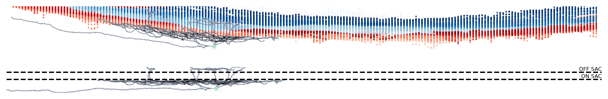

# pywarper

[](https://badge.fury.io/py/pywarper)

`pywarper` is a Python package for conformal mapping-based warping of retinal morphologies, based on the [MATLAB implementations](https://github.com/uygarsumbul/rgc) (Sümbül, et al. 2014). 




## Installation

To install the latest tagged version:

```bash
pip install pywarper
```

Or to install the development version, clone the repository and install it with `pip install -e`:

```bash
git clone https://github.com/berenslab/pywarper.git
pip install -e pywarper
```

## Usage

See [example notebooks](https://github.com/berenslab/pywarper/blob/main/notebooks/) for usage.

## Reference layers and the global map (EyeWire II)

`pywarper.layers` turns skeletons into the two SAC bands, any further depth layers, and the global map that every later warp uses.

```python
from pathlib import Path
from pywarper import layers

sacs = Path("/data/ew2/sacs")
on = layers.load_cells(sacs / "sac-on", "{id}/skeleton.npz")
off = layers.load_cells(sacs / "sac-off", "{id}/skeleton.npz",
                        ids=Path("off_sacs.txt").read_text().split())

bands = layers.fit_bands(on, off)
extra = [layers.soma_layer("on_soma", on, bands)]
for jump in (1, 2):
    mapping = layers.build_map(bands, extra, conformal_jump=jump)
    layers.save_map(mapping, f"global_map_j{jump}_20261116.npz")
print(layers.report(bands, extra, mapping))
```

**Where the skeletons are.** `load_cells(root, pattern)` reads whatever layout the pattern names, with `{id}` for the cell ID: `"{id}.npz"` for a flat folder, `"{id}/skeleton.npz"` for one folder per cell. With `ids`, exactly those cells are read, and a listed cell without a file is an error. Skeletons that are not files go in through `layers.Cells.from_skeletons({cell_id: skeleton})`. The unit is taken from each skeleton (nm or µm); files that carry none need `unit=`. Flattened skeletons and cells that do not lie in the EyeWire II volume are refused.

**Adding a layer.** A cell type that stratifies in a narrow sheet can serve as a further depth reference:

```python
a17 = layers.load_cells(root, "{id}/skeleton.npz", ids=a17_ids)
print(layers.cross_validate("stratum", a17, bands, depth=-10.5, half_width=2.5))
extra.append(layers.stratum_layer("a17", a17, bands, depth=-10.5, half_width=2.5))
```

`depth` and `half_width` say where to look for the stratum and how wide it is, in flattened units (ON SAC band 0, OFF SAC band 12). `cross_validate` fits the layer on half of the cells and reports the other half's depth spread and its slopes across the tissue, with the bands alone and with the layer; a layer is worth adding when it lowers them. `check_cells(a17, layer)` lists the cells that do not sit on the layer. Types with fewer than about 250 cells do better with `smoothness=50` to `150`.

A warped skeleton records per node which layers were observed in its column (`extra["coverage"]`); `pywarper.warpers.get_coverage` sums that per cell.
